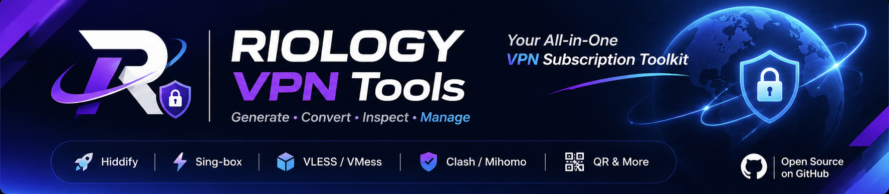

# ⚡ URI Link & Subscription Generator

**Turn raw proxy URIs, Base64 blobs, or JSON configs into clean, live subscription links & QR codes — in one click.**

  
  
  

  
  
  
  
  
  

---

## ✨ Why Use This?

Raw server links pasted from channels or panels are often messy, duplicated, or incompatible across different VPN apps. **URI Link Generator** automatically parses, fixes, deduplicates, and converts them into clean, ready-to-import subscriptions for every major client.

- **🚀 Instant Short Links & QR Codes** — No bloated, mile-long URLs. Get a clean short subscription link and a scannable QR code.
- **🤖 Built-in Telegram Bot ([`@uri_gen_bot`](https://t.me/uri_gen_bot))** — Forward raw links, Base64 text, or `.txt`/`.json` files directly in Telegram and tap your client to get your link + QR code.
- **📲 One-Click App Import (Web UI)** — Import straight into **Hiddify**, **v2rayNG**, or **Clash / Mihomo** with a single tap.
- **🧹 Auto-Normalization** — Automatically repairs malformed parameters, strips incompatible `xhttp` nodes for Sing-box/Clash, and removes duplicate servers.
- **☁️ 100% Edge-Powered** — Runs completely on **Cloudflare Workers** with zero external database required.

---

## 🤖 Use via Telegram Bot (`@uri_gen_bot`)

The fastest way to convert links on mobile or desktop without opening a browser:

  

1. **Send or forward** any message containing raw proxy links, a Base64 subscription, or a `.txt` / `.json` config file to **[`@uri_gen_bot`](https://t.me/uri_gen_bot)**.
2. Review the instant **node summary** (active nodes, Sing-box/Hiddify ready, Xray-only, auto-fixes applied).
3. Tap your client button (**Hiddify / Sing-box**, **Xray-core / v2rayNG**, **Sing-box JSON Profile**, or **Clash / Mihomo**) to receive your **QR code + short subscription link**.

---

## 🌐 Use via Web App

1. **Paste** your raw links, Base64 subscription text, or JSON outbounds (or drag & drop a `.txt` / `.json` file).
2. **Choose your client** before generating:
   - **Hiddify / Sing-box**
   - **Xray / v2rayNG**
   - **Sing-box JSON**
   - **Clash / Mihomo**
3. Click **Generate link** to get your short subscription URL, QR code, and **One-Click Import** button.
4. *(Optional)* Expand the **Nodes Inspector** to search, filter, or edit individual nodes.

---

## 🎯 Supported Clients & Formats

| Client / Core | Output Format | One-Click Import |
| :--- | :--- | :---: |
| **Hiddify / Sing-box** | Base64 / Filtered URI Subscription (`?target=singbox`) | ✅ `hiddify://` |
| **Xray-core / v2rayNG / v2rayN / Streisand** | Base64 / Full URI Subscription (`?target=xray`) | ✅ `v2rayng://` |
| **Sing-box (Desktop / Mobile / Router)** | Full JSON Outbound Profile (`?target=singbox-json`) | ✅ `sing-box://` |
| **Clash / Mihomo (Clash.Meta)** | Ready-to-use YAML Profile (`?target=clash`) | ✅ `clash://` |

---

<b>🛠️ Self-Hosting on Your Own Cloudflare Worker (Optional)</b>

 

Want to run your own private instance and bot? Deploy this repo to **Cloudflare Workers** in 3 steps:

1. **Deploy the Worker** using the button at the top (or `npx wrangler deploy`).
2. **Create a Telegram Bot** via `@BotFather` (`/newbot`) and add `TG_BOT_TOKEN` in **Cloudflare Dashboard → Worker → Settings → Variables and Secrets**.
3. **Register & Link Storage**:
   - Visit `https://<your-worker>.workers.dev/api/telegram/setup` once to register the webhook.
   - Message `/id` to your bot, copy the `Chat ID`, and add it as `TG_CHAT_ID` in Cloudflare Variables and Secrets for permanent short links.
   - *(Optional)* Add `TG_ALLOWED_USERS` (comma-separated Telegram User IDs) to restrict your bot to private use.

---

  Built for fast, clean proxy subscriptions • Licensed under <a href="https://github.com/riology/URI-link-generator/blob/main/LICENSE">MIT</a>

